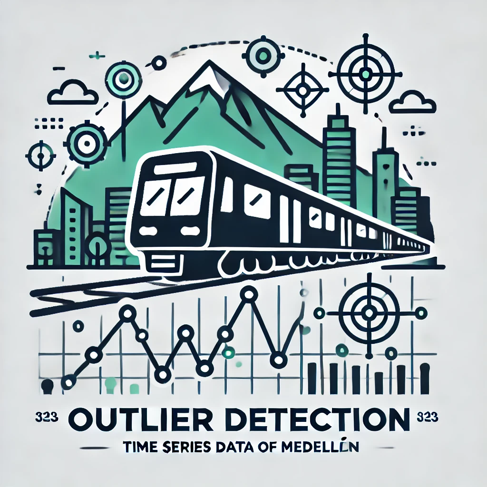

# Detección de anomalías en la afluencia horaria — Línea A, Metro de Medellín



Sistema que señala **días y horas cuya afluencia se desvía de lo esperado para su contexto de calendario** (día de la semana, festivo, Semana Santa, temporada de fin de año y nivel reciente de demanda), y explica qué horas se desvían, en qué dirección y con qué magnitud. Incluye una aplicación Streamlit, un pipeline reproducible y una evaluación con protocolo pre-registrado.

> **Dictamen de producción (2026-11-23):** **no apto como mecanismo de detección temprana de incidentes** (sin registro de incidentes para validar; detectó 1 de 3 incidentes reales verificados; no anticipa). **Apto con condiciones** como apoyo de revisión retrospectiva y control de calidad de los datos. Ver [`docs/validacion/DICTAMEN_PRODUCCION.md`](docs/validacion/DICTAMEN_PRODUCCION.md).
>
> **Estado del modelo (2026-11-23):** funcional y validado de extremo a extremo, pero **no cumple todos los criterios pre-registrados**. Cumple la tasa de alertas, la detección de perfiles incoherentes con el calendario, la superioridad frente al sistema original, la generalización a 2019 y la detección de eventos reales. **No cumple** la sensibilidad mínima a anomalías moderadas y severas ni la tasa máxima de alertas en festivos. Detalle en [`docs/validacion/INFORME_FINAL.md`](docs/validacion/INFORME_FINAL.md).

> **Fase 3 (2026-11-24): plataforma multilínea.** Página `Red multilinea` (en el menú lateral de la app) con:
> - un esquema de relaciones entre las 11 líneas;
> - reproducción por hora;
> - un detector de coherencia de red (recall moderado de la Línea A de 0,70 a 0,90 con el mismo presupuesto de alertas);
> - pronóstico del día siguiente por línea y hora (WAPE 11–28 % menor que el naive);
> - un catálogo de lo validado y lo descartado.
>
> La plataforma sigue sin servir para detección temprana ni localización de fallas: para eso faltan datos por estación y telemetría. Ver [`docs/validacion/F10_fase3_plataforma.md`](docs/validacion/F10_fase3_plataforma.md) y [`docs/fase3/HOJA_DE_RUTA_DATOS.md`](docs/fase3/HOJA_DE_RUTA_DATOS.md). Para reconstruir los artefactos: `python scripts/fase3/build_plataforma.py` (~12 min).

## Inicio rápido
```bash
python -m venv .venv && source .venv/bin/activate   # Python 3.10
make install            # pip install -r requirements-dev.txt && pip install -e .
make app                # streamlit run app.py
make test               # tests (unitarios, integración, app, contraste de auditoría) + cobertura ≥ 80 %
make reproduce          # pipeline completo: datos → selección → holdout → externo → artefacto (~10 min)
make determinism        # D9: dos ejecuciones aisladas con hashes idénticos
make install-research && make reproduce-research    # incluye las comparaciones con autoencoders (TensorFlow)
python scripts/run_daily.py --fecha 2023-08-28 --monitor     # operación por lote con registro de auditoría
python scripts/production_validation.py                     # simulación cronológica de producción (F8)
make e2e                                                    # E2E y auditoría UX con navegador (node + playwright)
```

## Cómo funciona
1. **Datos** (`src/metro_anomaly/data.py`): valida el esquema de los archivos oficiales, normaliza las líneas, resuelve duplicados y **no imputa** (los faltantes se reportan como problema de calidad de datos). Se puntúan las horas 04–22; las 23:00 se excluyen (ver la ficha de datos).
2. **Calendario** (`calendar.py`): festivos de Colombia, Semana Santa, temporada de fin de año, vísperas y jornadas electorales (estas últimas solo para anotar).
3. **Modelo** (`detectors.py`, `perfil_contextual`):
   - perfil robusto (mediana/MAD) por tipo de día y hora, en log1p, relativo a un **nivel causal** (solo usa días anteriores);
   - z por hora;
   - score diario `peak_shift`, que capta tanto picos localizados como desplazamientos de todo el día.
4. **Umbral**: cuantil 95 % de los scores fuera de muestra de DEV (presupuesto de alertas del 5 %), congelado en `artifacts/modelo.json`.
5. **Categorías de salida:** *sin anomalía estadística*, *anomalía estadística* (con severidad empírica y frecuencia histórica), *posible problema de datos* y *efecto de medición conocido* (p. ej., no cobro electoral). Ninguna equivale a un incidente confirmado.
6. **App** (`app.py`, `service.py`): explorar cualquier fecha del histórico o cargar un `.xlsx`/`.csv` con el formato oficial (uno o varios días; para fechas futuras se necesitan ≥ 4 semanas previas en el archivo).

## Validación (resumen)
Protocolo:
- DEV (2022-01…2023-06) para seleccionar el modelo, con rolling origin mensual;
- HOLDOUT (2023-07…2024-06) con modelo y umbral congelados;
- EXTERNO: 2019 y estrés COVID 2020–2021.

La verdad de terreno son **anomalías sintéticas** con un catálogo pre-registrado y **eventos reales con fuente oficial**. Las etiquetas heurísticas del proyecto original **no** se usan como verdad: se demostró que reflejan sobre todo el calendario.

| Criterio | Resultado | |
|---|---|---|
| Tasa de alertas (holdout) 2–10 % | 2,2 % | ✔ |
| Recall severas ≥ 0,95 / moderadas ≥ 0,80 | 0,894 / 0,506 | ✘ / ✘ |
| Alertas en festivos ≤ 10 % | 11,1 % (Navidad y Año Nuevo) | ✘ |
| Perfil de festivo en día hábil ≥ 0,95 | 1,00 | ✔ |
| Mejor que el autoencoder original | +0,207 de recall moderado (IC > 0) | ✔ |
| Transferencia 2019 ≤ 15 % de alertas | 7,5 % | ✔ |
| Eventos reales prospectivos (COVID 2020, elecciones 2019 y 2023) | 4/4 | ✔ |
| Causalidad y determinismo | tests + doble ejecución | ✔ ([`reports/determinismo.md`](reports/determinismo.md)) |

¿Por qué no un autoencoder? Con el protocolo correcto, el AE original queda por debajo en todos los criterios y no detecta perfiles de festivo en días hábiles. El AE contextual tampoco los detecta y genera demasiadas alertas en festivos ([`reports/seleccion_dev.md`](reports/seleccion_dev.md)).

## Limitaciones principales
- Sensibilidad ~50 % a anomalías moderadas, la más débil en aumentos por evento.
- Falsos positivos en Navidad y Año Nuevo.
- Readaptación lenta ante cambios de régimen.
- Solo Línea A.
- La validación primaria es sintética: faltan incidentes operativos verificados. Ver [`docs/MODEL_CARD.md`](docs/MODEL_CARD.md).

## Estructura
```
app.py                  App Streamlit (nueva)
src/metro_anomaly/      data, calendar, detectors(_nn), injection, labels, evaluation, artifacts, service
scripts/                data_quality, label_quality, run_eval, select_model, evaluate_holdout, evaluate_external,
                        build_artifact, reproduce, check_determinism
tests/                  unit/, integration/, e2e/, audit/ (contraste independiente de la auditoría)
artifacts/modelo.json   modelo final + umbral + procedencia
configs/seleccion.yaml  selección congelada (y umbrales de las líneas base)
reports/                calidad de datos, etiquetas, selección DEV, holdout, externo, determinismo
data/                   archivos oficiales 2019–2024 + eventos_reales.csv
legacy/                 app original (solo referencia; ver legacy/README.md)
dev/                    notebook y artefactos originales (solo referencia de la auditoría)
audit/                  auditoría técnica y sus experimentos
docs/                   PLAN_MAESTRO, BITACORA, MODEL_CARD, DATA_CARD, validacion/
```

## Validación de producción y UX (fase 2)
Simulación cronológica sin fuga, latencia intra-día, escenarios multi-día, robustez, eventos reales en fuentes oficiales, auditoría UX con navegador (35 pasos, axe, responsivo, UI = backend). Ver [`docs/validacion/F8_F9_produccion_y_ux.md`](docs/validacion/F8_F9_produccion_y_ux.md) y el protocolo de validación operacional [`docs/PROTOCOLO_VALIDACION_OPERACIONAL.md`](docs/PROTOCOLO_VALIDACION_OPERACIONAL.md).

## Trazabilidad
[Auditoría](audit/AUDITORIA.md) → [Plan maestro](docs/PLAN_MAESTRO.md) → [Bitácora](docs/BITACORA.md) → informes por fase en [`docs/validacion/`](docs/validacion/).

## Datos
Archivos de afluencia en `data/`. Según el README original provienen de Kaggle: https://www.kaggle.com/datasets/roysandoval/afluencia-metro-de-medelln-2023 (procedencia y licencia no verificadas contra una fuente oficial del Metro).
